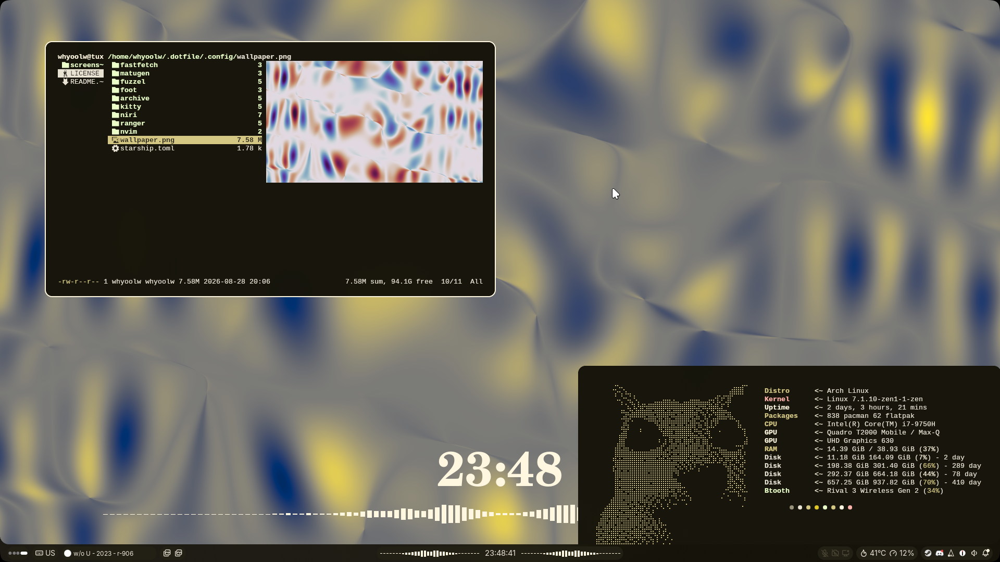

| Environment   | Name   |
|---------------|--------|
| DE            | niri  ⭐ |
| Bar           | noctalia |
| Launcher      | fuzzel |
| Login Manager | tty    |
| Shell         | fish + starship  |



## Установка

Чистый Arch, обычный пользователь с `sudo`:

```bash
bash -c "$(curl -fsSL https://raw.githubusercontent.com/octavich/.dotfile/main/install.sh)"
```

Скрипт клонирует репозиторий в `~/.dotfile` и запускается уже оттуда. Из готового клона:

```bash
git clone https://github.com/octavich/.dotfile ~/.dotfile
~/.dotfile/install.sh --dry-run   # посмотреть, что будет сделано
~/.dotfile/install.sh
```

После перезагрузки логинишься на `tty1`, fish запускает `niri-session`.

## Что делает `install.sh`

1. Включает `[multilib]` и обновляет систему (`pacman -Syu`).
2. Ставит `paru`, если нет ни `paru`, ни `yay`.
3. Ставит пакеты из `packages/*.txt`: сначала ищет в официальных репозиториях, потом в AUR.
   Если один пакет из пачки упал, остальные доставляются по одному, а упавший попадает в итоговый отчёт.
4. Определяет видеокарту и ставит драйверы (Intel / AMD / NVIDIA). Для NVIDIA:
   `nvidia-open-dkms`, заголовки для всех установленных ядер, профиль против утечки VRAM в niri
   (из niri wiki), убирает хук `kms` из `mkinitcpio.conf` (по Arch wiki).
5. На ThinkPad включает `thinkpad_acpi fan_control=1`, чтобы работал `niri/thfn_`.
6. Делает симлинки `~/.config/<имя>` → `~/.dotfile/.config/<имя>`. Всё, что там лежало,
   переносится в `~/.local/state/dotfile/backup/<дата>/`.
7. Клонирует плагины ranger (`ranger_devicons`, `ranger-archives`) и иконки Neuwaita,
   ставит vim-plug и плагины nvim, задаёт тёмную тему GTK, делает fish login-шеллом.

Повторный запуск безопасен: уже сделанное пропускается.

## Опции

| Опция | Что делает |
|-------|------------|
| `-n`, `--dry-run` | только показать действия |
| `--only=fonts,apps` | ставить только эти группы |
| `--skip=apps,lib32` | пропустить группы |
| `--no-packages` | только конфиги |
| `--no-configs` | только пакеты |
| `--gpu=none` / `--gpu=intel,nvidia` | драйверы вручную вместо автоопределения |
| `-y`, `--yes` | не показывать PKGBUILD из AUR на ревью |
| `--unlink` | убрать симлинки и вернуть бэкапы |

`NVIDIA_DRIVER=nvidia-580xx-dkms ./install.sh` — для старых карт, которые `nvidia-open` не поддерживает (до Turing).

## Пакеты

Группы лежат в `packages/`, имя группы — имя файла без номера:

| Группа | Что внутри |
|--------|------------|
| `base` | base-devel, git, архиваторы, утилиты |
| `desktop` | niri, noctalia, порталы, pipewire, fuzzel, clipse, jams, matugen… |
| `terminal` | fish, starship, kitty, foot, nvim, ranger и всё для превью |
| `fonts` | Liberation Mono, Monocraft, Nerd Font символы, Noto |
| `apps` | nautilus, mpv, obs, zen, spotify, equibop, materialgram, claude-desktop… |
| `lib32` | 32-битные библиотеки для Wine / PortProton |
| `gpu` | драйверы, определяются автоматически |

Добавить пакет — дописать строку в нужный файл. `a|b` значит «первый из `a`, `b`,
найденный в официальных репах, иначе первый найденный в AUR».

## Конфиги

Всё, что лежит в `.config/`, линкуется в `~/.config/`, кроме `.config/archive` (старые конфиги
waybar, swaync, ghostty, yazi, fusuma — хранятся, но не ставятся). Правки в `~/.config/...`
сразу видны в репозитории, их можно коммитить.

## Вручную

- **Курсор `Remus-White`** (указан в `niri/config.kdl`): его нет в AUR, скачать с
  [gnome-look](https://www.gnome-look.org/p/2355234) и распаковать в `~/.local/share/icons/`.
- **Свои программы** из биндов niri: `thfn-gtk`, `translator-gtk`, `calc-gtk`,
  `currency-gtk`, `/usr/local/bin/ytdl-gtk` — установщик их не ставит.

## Проверка

```bash
~/.dotfile/scripts/doctor.sh
```

Проверяет программы, симлинки, `niri validate`, шрифты, иконки и курсор, pipewire, порталы,
noctalia и модули NVIDIA. Ничего не меняет.
